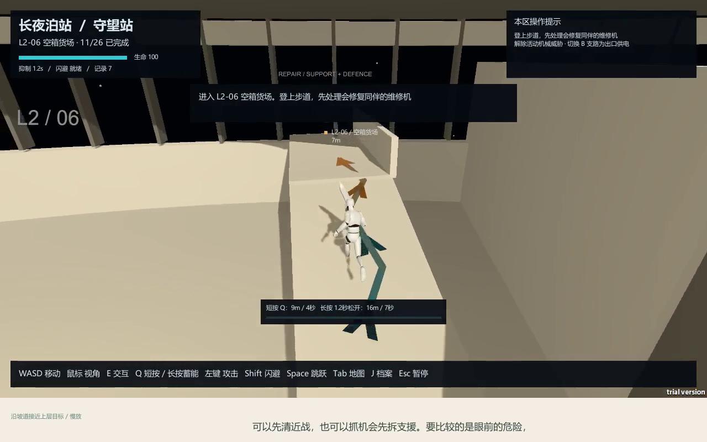
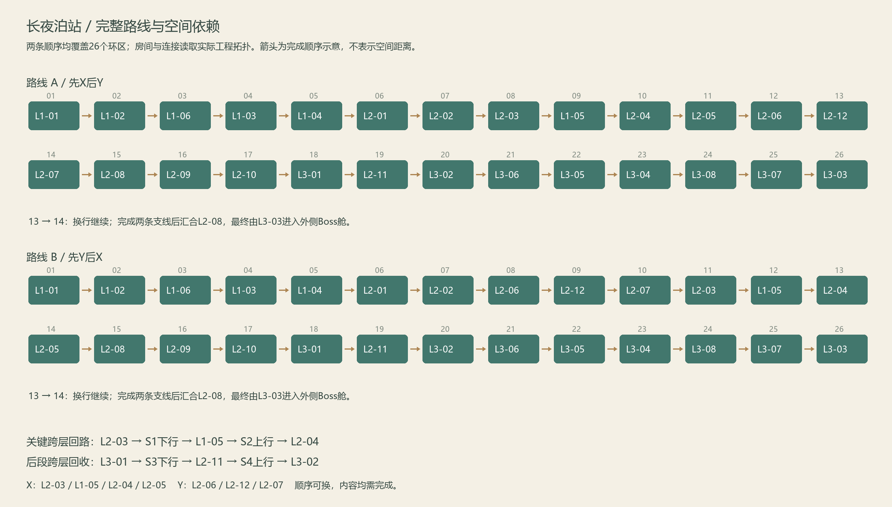

# 长夜泊站 · Last Light Station

**三层交织的空间站关卡白盒｜Unity｜第三人称动作探索｜Windows**

一座因感染而被居民主动放逐的空间站。玩家在维护设备、恢复通路的过程中，取回隔离事件的记录，完成一次迟来的交接。

本作品展示的重点是：在既有房间、敌人和机关数量受限的情况下，如何通过跨层入口、通道连接、任务顺序和局部高差增加探索与判断。

## 快速查看

| 想了解什么 | 入口 |
|---|---|
| 从立项到成品，哪些问题推动了修改 | [https://github.com/yukidrift2358-oss/LastLightStation-LevelDesign/releases/download/portfolio-v1.0/LastLightStation-Iteration-CN.mp4](https://github.com/yukidrift2358-oss/LastLightStation-LevelDesign/releases/download/portfolio-v1.0/LastLightStation-Iteration-CN.mp4) · [版本更新记录](docs/03-iteration-history.md) |
| 整体动线、房间拆解和设计取舍 | [https://github.com/yukidrift2358-oss/LastLightStation-LevelDesign/releases/download/portfolio-v1.0/LastLightStation-DesignShowcase-CN.mp4](https://github.com/yukidrift2358-oss/LastLightStation-LevelDesign/releases/download/portfolio-v1.0/LastLightStation-DesignShowcase-CN.mp4) · [设计说明](docs/02-level-design.md) |
| 教学、26区与Boss的完整操作 | [https://github.com/yukidrift2358-oss/LastLightStation-LevelDesign/releases/download/portfolio-v1.0/LastLightStation-FullWalkthrough-CN.mp4](https://github.com/yukidrift2358-oss/LastLightStation-LevelDesign/releases/download/portfolio-v1.0/LastLightStation-FullWalkthrough-CN.mp4) · [章节](docs/video-chapters.md) |
| 直接体验最终白盒 | [https://github.com/yukidrift2358-oss/LastLightStation-LevelDesign/releases/download/portfolio-v1.0/LastLightStation-Windows.zip](https://github.com/yukidrift2358-oss/LastLightStation-LevelDesign/releases/download/portfolio-v1.0/LastLightStation-Windows.zip) |
| 快速阅读设计文档 | [v6结构设计 PDF](docs/pdf/level-design-v6.pdf) · [后续设计更新 PDF](docs/pdf/design-update.pdf) |

视频为中文合成女声及同步字幕；重点拆解中的局部慢放有标记。视频文件和试玩包集中放在 [https://github.com/yukidrift2358-oss/LastLightStation-LevelDesign/releases/tag/portfolio-v1.0](https://github.com/yukidrift2358-oss/LastLightStation-LevelDesign/releases/tag/portfolio-v1.0)，可下载查看。

## 跨层入口、支线顺序与战斗配置

### 跨层入口与返回路线

生活环的气密档案室不能从本层直接进入，需要从工业环下行取档，再从另一段通道返回上层。后段的回声天线复用这一关系，把先前学过的认路方式与接力、短时抑制接在一起。

### 两条必经支线的先后选择

工业环的安全房提供两条支线：系统线偏跨层档案与接力，货场线偏交火与维修支援。两条都要完成，可以交换先后；原有桥梁在轴心转向，已完成区域保留状态，回访不必重复清场。

### 高低位目标与机制组合

近战威胁在地面，维修机位于约三米高的服务步道。坡道、掩体和修复关系影响先处理谁、从哪里接近。机制则从单项操作发展到先密封、再接电、最后抑制的综合条件。九处安全房穿插其中，提供状态恢复、档案阅读和路线确认的时间。

## 项目范围与阅读顺序

- 空间：6区生活环、12区工业环、8区隔离环，共26区，再接圆形Boss场地。
- 机制：供电分流、气密隔离、短按与蓄力抑制，以及继电器顺序和出口窗口等组合。
- 敌人：冲锋体、射线哨兵、维修机、牵引机。
- 叙事：主动隔离、生存代价、取回姓名，最终只发送记录，空间站继续保持隔离。

建议按 **[项目概览](docs/01-project-brief.md) → [设计拆解](docs/02-level-design.md) → [迭代顺序](docs/03-iteration-history.md) → [叙事与信息更新](docs/04-latest-update.md)** 阅读。工程入口见 [UnityProject](UnityProject)，复现步骤见 [BUILD.md](BUILD.md)。

## 实现与验证

已验证环境为 Unity **2022.3.62f3c1**、Windows x64。两条代表路线均完成26区及Boss；完整录像对应的运行检查包含71次原生交互，15次已读档案翻阅检查通过。详见[验证范围与证据](docs/06-validation.md)。这些结果用于说明功能和路线成立，不作为陌生玩家体验统计。

## 资源来源与许可

模型与动画来自保留原始许可的 Kenney、Quaternius CC0资源，见[第三方资源说明](THIRD_PARTY_NOTICES.md)。

仓库从当前源码快照开始记录，早期迭代按文档回顾；版本顺序不伪装成历史Git提交。未上传Unity缓存、个人工作目录、账号配置、原始制作日志或其他求职材料。
