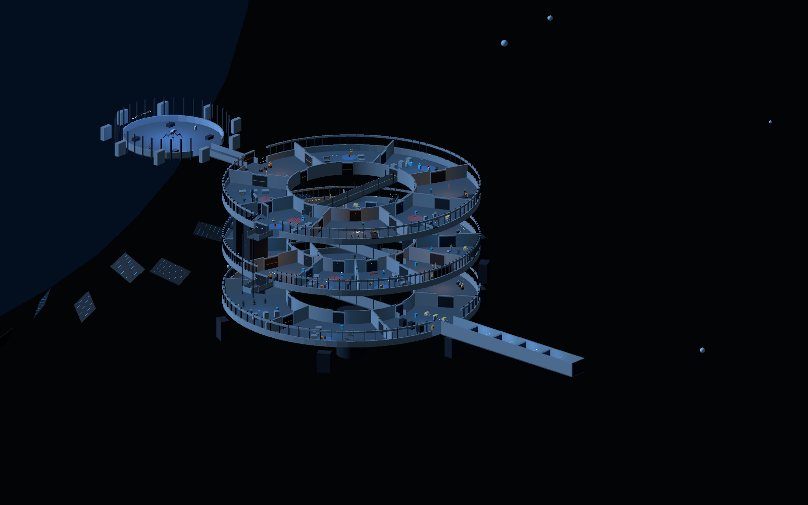
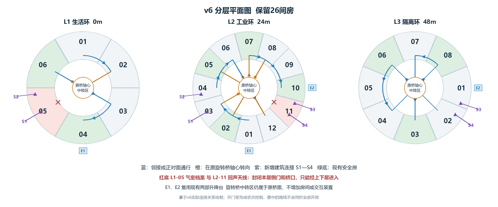
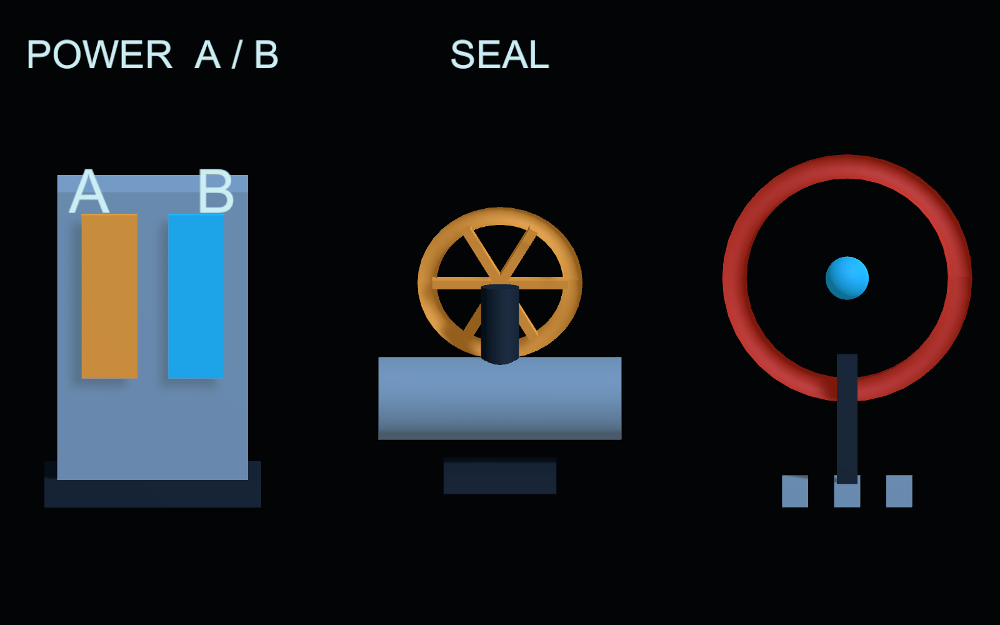
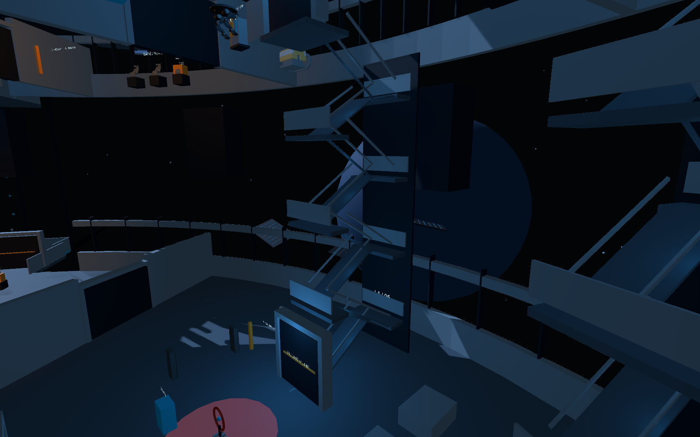

> 本文保留 v6 的结构设计基线。配色、档案与指引的后续改动见[信息与叙事更新](04-latest-update.md)。文中蓝灰截图是该阶段的历史配色。

# 长夜泊站关卡设计与设计思路
从玩家判断出发  用空间关系增加丰富度
v6 三维动线与路线选择修订  2026年10月20日

我希望玩家对这座空间站的认识逐渐改变：最初把它当作一组等待修复的房间，随后发现通路之间存在依赖，最后理解居民为何亲手把空间站放逐。动作探索与悲剧叙事因此共享同一个过程——先恢复功能，再看见功能背后的人。

## 这次丰富度来自哪里

我保留6／12／8共26个环区、四种敌人和既有机制配置，把变化放在“如何到达”与“何时选择”上。两间房必须借另一层进入；工业环允许交换两条支线的完成顺序；原有旋转桥支持在轴心转向，连接非正对面的房间。

设计重点是让同一个空间产生新的关系。玩家需要从目标的高度推断入口，从已解锁的连接决定顺序，也会在重见熟悉地点时重新理解自己的位置。跨层不能只是上下楼的动画，选择也不能只是两扇最终通向同一条走廊的门。

## 关键设计判断

把楼层从进度标签变为解题条件；把通道从被动过场变为可以安排的行动顺序；用安全段承接空间理解与情绪变化。以下用连接、案例与两条完整路线说明这些判断，并把自动验证与尚待真人测试的体验结论分开。
---
# 为什么让玩家向下走 才能继续向前
## 高度成为入口条件

原先逐层清空的结构容易形成“走完一层，再上楼重复”的预期。我把L1-05气密档案的本层侧门与桥口保持关闭，安排L2-03 → S1下行 → L1-05 → S2上行 → L2-04。目标仍在熟悉的生活环，入口却属于工业环；玩家必须把两层理解为一套空间。

## 让回到旧地点产生新的意义

气密档案并非增加的一间奖励房。它保存居民共同签署的隔离授权。先在工业环遭遇仍在工作的安保系统，再下到生活环看到主动隔离的决定，会使玩家重新解释刚才的危险：系统延续的既是失控指令，也是居民保护家园的选择。

后段用L3-01 → S3下行 → L2-11回声天线 → S4上行 → L3-02回收同一空间规则。第一次让玩家学会跨层寻找入口，第二次要求把这种认识与继电器、短时抑制组合。两处都无法用本层绕行代替，Z轴才是实际条件。

## 复杂度要有边界

四段连接使用可步行的折返坡道，不放置新敌人、任务道具或操作装置，也不要求精密跳跃。坡道承担高度转换和观察时间，挑战留在原有房间里。两部既有观景升降台继续承担较长的安全过渡；没有把所有上升都改成同一种通行方式。
---
# 选择应改变行动计划 而不制造遗漏焦虑
## 只在能够理解的节点交出顺序权

我把工业环L2-02休眠宿舍作为选路点。这里本来就是安全房，恢复后再比较去向，玩家可以把注意力用于计划。选择沿用现有出口交互，不增加新控制器或新钥匙。

系统支线X为L2-03 → L1-05 → L2-04 → L2-05；货场支线Y为L2-06 → L2-12 → L2-07。X混合视线管理、跨层与接力，Y集中处理支援关系和连续战斗。玩家可以先完成任意一条；两条均完成后，才开放通往L2-08的共同后段。

## 先后选择改变体验次序

X先行时，玩家更早理解档案与跨层依赖；Y先行时，先处理修复链和近战压力，再转入系统问题。它们没有不同结局，也没有凭空生成不同内容。选择的价值在于安排任务顺序与压力偏好，而非扩大房间数量。

两条支线分别以既有安全房L2-05、L2-07收尾，避免交换顺序后把两组高压段硬接起来。两条代表路线都覆盖26间房、经过9处既有安全房，连续战斗房最多两间。这是编排边界，并不等同于心流已经得到验证。

## 原桥如何提供更多连接

原有对接桥既能直穿对面，也能承担折向中转：在出口选定目的地，桥先对齐来路；玩家走到原桥轴心后站稳，随桥转向，再走剩下半段到另一房间。全程仍使用原桥面，没有额外中枢房间。

中心转向把选择落实成可感知的空间动作。旋转时临时锁定移动并关闭端口，锁定后再开放目标端；等待过程中保留观察，避免把选择仅表现为菜单里的传送。五组非正对面连接服务两条支线的组织，完整路线见文末。

## 回退也属于选择的成本设计

开启条件依据已完成区域，而非固定步序。通路解锁后可以反向使用，已完成房间不重置敌人，换电也不会重新锁住静态出口。玩家可以返回阅读和确认位置；尚未完成的房间仍需解决原有目标，回退不会替它登记完成。
---
# 机制复用需要先降低辨认成本
## 三类轮廓分别回答三种操作

同样的终端外形会迫使玩家靠提示文字分辨功能。我把电力做成高直柜体与A／B双窗，把隔离做成横向粗管与实体手轮，把扫描做成通透环体与细支架。三者首先依靠体量、方向和空实关系区分，再用颜色表达状态。

这是装置表现的替换，交互范围与数量保持原有配置。A／B窗突出当前供电，阀轮显示关闭状态，扫描环响应抑制。轮廓负责“这是什么”，状态负责“现在怎样”，避免同一个颜色同时承担所有信息。

## 难度增长放在关系上

基础段先验证操作后果；强化段改变操作用途；最终段要求组织已有知识。例如监视廊的B支路既为通路供电，也让哨兵恢复攻击；隔离前室则要求先密封、再接B电、最后使用Q，在有效窗口登记。需要增加的是因果判断，不是按键数量。

跨层后，难度阶段仍由任务组合控制。回到生活环的档案房让玩家从刚经历的战斗转入观察和读取；进入隔离环后再回工业环处理回声天线，是从综合操作切换到短时接力。压力允许起伏，整体能力要求逐步提高，不能把所在楼层直接等同于当前难度。

## 引导解释当前行动 而不替玩家作选择

灯带指向未完成操作、已解锁出口或正在使用的通道。跨层段沿折返路径铺设，桥中心转向时暂收灯带，锁定后继续指向目的地。地图补充楼层和跨层入口，出口界面明确哪些目的地可回访；路线选择仍由玩家完成。
---
# 高差和节奏如何共同服务判断
## 局部高差改变目标优先级

监视廊把射线放在上层、冲锋放在下层，让遮挡与侧移分别回应不同威胁。维修机则在高处延长下层战斗：先抑制支援，或承担登坡成本先拆支援，成为对同一组敌人的不同处理方式。没有增加同房敌人数量，变化来自位置和依赖。

我保留约三米服务步道的既有尺度，并在跨层入口附近挪开冲突的掩体、继电器与装饰。调整的目标是让路径、视线和操作点各有清楚用途，避免增加纵深之后反而遮住攻击或堵住原有目标。

## 安全段需要兑现承诺

九处既有安全房仍提供生命与技能恢复，不加入伏击。两部观景升降和四段跨层步道都不添加战斗内容，但步道不另计为房间或恢复点。长距离上下行会增加移动时间，恢复价值必须与耗时一起判断，不能把没有敌人直接当作休息成功。

短按Q为9米／4秒，蓄满后松开为16米／7秒，并付出更长冷却。蓄能反馈、路径与安全出口共同帮助玩家预先安排窗口。挑战后的恢复让玩家重新获得计划空间，后段综合挑战才能考查主动选择，而非资源不足时的被动等待。
---
# 叙事和失败范围要支持探索意愿
## 两种顺序仍通向同一个情感问题

支线X围绕系统、档案和隔离授权，支线Y围绕空箱、维修与物资压力。它们都是可以独立理解的生活片段，因此交换顺序不需要新增剧情。完成两条支线后再进入共同后段，隔离环的名单、种子和最后交接便建立在玩家已见过生存代价的基础上。

这次跨层回望承担一次认识更新：从上层回到生活环，玩家既能识别已经走过的结构，也可能重新理解当时忽略的痕迹。我的目标不是让档案更难找，而是让“再次来到这里”有新的观看理由。

## 容许试路 才能让顺序选择有意义

死亡保留已取得记录与已完成区域；未完成遭遇按原规则重置，已完成遭遇不复活。通行检查点位于静态入口，避免失败后被放回正在转动的桥面。回退不撤销完成标记，玩家不必通过重复打完一组敌人来支付看地图的代价。

继电器错误仍只重置本房接力，错过抑制窗口仍可重试。代价集中在正在考查的判断上：若失败来自操作次序，就让玩家重试次序；若只是不确定入口，不应再收取一场战斗的成本。

## Boss 回收已建立的空间与操作经验

最终房仍通向开阔圆形Boss场。外围设备要求在读攻击预告的同时安排隔离、供电和抑制，半血护盾把此前学习的关系重新组织为行动计划。没有用新机关代替最后一次综合考查。

守门者仍执行禁止离站的命令，使机制阻碍与居民保护家园的意愿来自同一套系统。玩家解除协议并发出姓名记录，通关才成为一次有含义的交接。选路改变到达这个结尾的经验顺序，结尾回收的核心问题保持一致。
---
# 如何验证亮点 而不把意图当作结论
## 已落实的约束

26个环区保留。逐房核对敌人数、交互总数、电力、隔离、继电器、档案、出口、扫描和泄漏数量，与修改前一致；教学对象数量也未增加。四段新增内容均为建筑连接，没有额外遭遇或机制类型。既有白色人形角色、挥刀与敌人行为修复继续保留。

## 路线图与程序各证明一部分

两条代表路线分别先X后Y、先Y后X，均覆盖全部26区。抽象状态检查涉及517个可达状态，均可到达Boss；去掉任意一段S1—S4都无法完成必经区域。这支持跨层连接的必要性，前提是房间目标可解且完成标记单向保留。

v6 Windows构建为0错误、0警告。路线A通过516项、路线B通过516项自动检查；另有32项坡道双向专测。回归实际走过相邻通道、直穿、桥中心转向、升降及四段步道，包含门侧进出、偏线转角、反向返回和桥面暂停／死亡重试。目标操作由程序安排，不能替代真人探索；文件指纹与日志见随项目交付的v6验证报告。

## 真人试玩仍要回答什么

第一，看见本层封门后，玩家能否从上层入口推断到达办法；若只能追提示，需要改善对上下关系的展示。

第二，选择支线时能否说明自己的理由，并在回访时认出来路；若只是随便点，需要改善出口信息或两条任务的差异，而不是再加岔路。

第三，跨层时间是否过长，恢复段是否促成观察；若折返坡道只被当作赶路，应缩短无判断的距离，不能靠“有Z轴”解释疲劳。

第四，综合操作失败后能否说出原因。若只会乱按，要改善状态反馈与因果关系。自动回归支持功能可运行，不证明心流、趣味、首次探索时长或情感目标已经成立。

## 用于介绍的简短讲述

“这次我用固定的26间房，重新组织到达关系：让两间房必须借另一层进入，把工业环拆成可交换顺序的两条支线，再让原桥支持轴心转向。这样，新增判断来自空间和时序，既不依赖堆敌人，也不依赖新机关。每条路线都保留恢复节点，并用完整路线和实际往返验证，避免复杂只停留在示意图上。”
---
# 路线A  先系统支线X 再货场支线Y
26区各完成一次；9处既有安全房；4段建筑跨层连接与2次观景升降；2次原桥轴心折向。
[查看路线A](images/route-a.png)
图例：绿底为既有安全房；紫线为S1—S4建筑连接；橙线为非正对面桥中心转向；蓝线为相邻、对穿或观景升降。圆内数字表示主线步序，通路解锁后允许回访。上下两段按步序衔接，末尾L3-03通往Boss舱。
---
# 路线B  先货场支线Y 再系统支线X
26区各完成一次；9处既有安全房；4段建筑跨层连接与2次观景升降；5次原桥轴心折向。
[查看路线B](images/route-b.png)
路线B先通过货场处理修复链，再回到系统支线。与A相比，任务总量和结束条件相同，连接组合及体验顺序不同。两条路线图代表可行的主线顺序；已解锁区域的回退和支线交错由状态检查另行覆盖。
