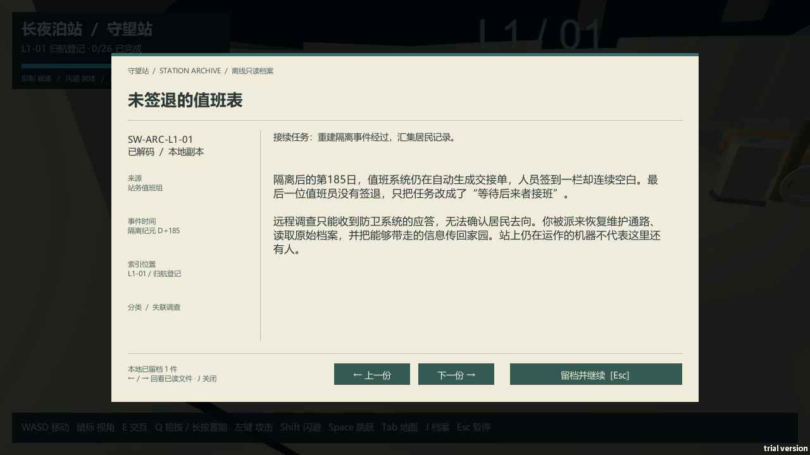

# 设计更新说明

本次修改由试玩反馈与方案复盘推动，不使用第三方评审意见，也不编造玩家测试数据。

## 修改依据与实际结果

旧版记录主要是短句与情绪片段，主动隔离、生存代价及最终交接之间的关系不够明确。新版在既有档案位置扩写正文，加入事件时间、来源、分类、文档编号与摘要。结尾明确仅发送信息，空间站保持隔离。姓名名单对应值班席位，并非全站人口统计。

档案阅读改为米白底、深绿文字的离线终端。正文可滚动，J可重开已读档案，左右方向键或按钮在已读文件间切换；阅读沿用原有暂停规则。未读文件不提前暴露。

三层空间的目标提示由距离扩展到楼层、区号、房间与高度方向；跨层旅行明确上行或下行。灯带仍使用实际可通行路径。支线选择补充任务链与末端安全房，两条都要完成，选择只改变顺序，回访保留完成状态。

## 空间结构与约束

维持6/12/8共26环区与Boss场地，维持原有敌人及装置种类、每房数量。第一环建立单项规则，第二环改变用途与位置，第三环组织依赖。9处安全房和无额外遭遇的跨层步道承接恢复、阅读和重新计划。

关键回路一：L2-03 → S1下行 → L1-05 → S2上行 → L2-04。
关键回路二：L3-01 → S3下行 → L2-11 → S4上行 → L3-02。

X支线：L2-03 → L1-05 → L2-04 → L2-05。
Y支线：L2-06 → L2-12 → L2-07。
从L2-02决定先后，X与Y都完成后才汇入L2-08。转向桥沿用原桥轴心，不添加枢纽房。

## 局部设计与取舍

空箱货场用地面近战与上层维修支援组织优先级，已有坡道承担接近路线；清除威胁后再完成出口供电。设计希望玩家比较接近支援目标与控制眼前威胁的代价，不以增加敌人数量制造变化。视频展示现有处理过程，另一种策略作为可选择的设计方向说明，不宣称已得到同等效率的实测结果。

跨层连接增加空间记忆负担，因此只把少量关键房间设计为借道进入，并在目标、原生地图和通路灯带中补足关系信息。支线选择设在安全区，避免同时阅读任务、选路与应对交火。档案扩写增加阅读量，因此以摘要帮助快速理解，正文供主动深入，已读回看减少一次记住所有信息的压力。

## 交付形式

重点展示版负责宏观结构、微观决策、修改前后对照与设计取舍。完整流程版保留全26区及Boss过程，分段说明当前目标、操作链与关卡作用。解说位于独立字幕带，完整保留原生游戏界面。原确认视频仍保留。

